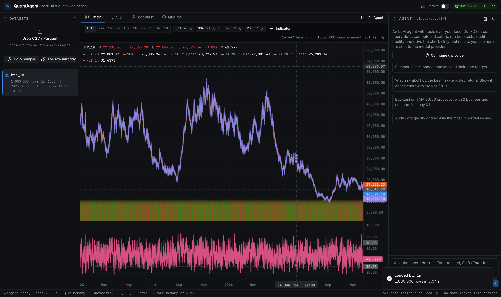
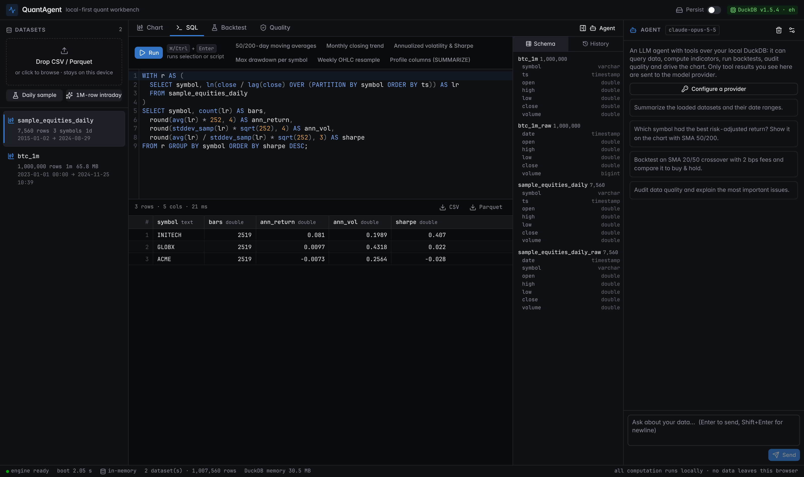
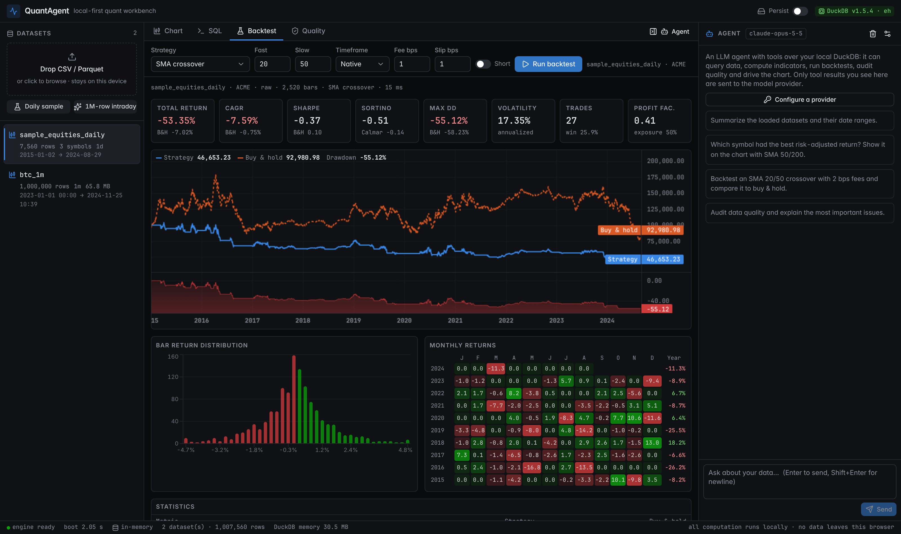
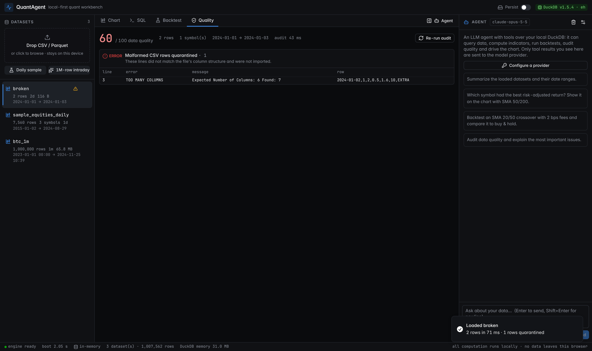

# QuantAgent — FinTech & Local Data Engine

A high-performance, **local-first workbench for AI algorithmic-trading agents**. Drop raw market data
(CSV / TSV / Parquet) into the browser, and it is parsed, normalized, queried, charted, audited and
backtested by **DuckDB-WASM running in a background Web Worker** — nothing is uploaded anywhere.
An LLM agent (Claude, OpenAI, Ollama, LM Studio, OpenRouter or any OpenAI-compatible server) can
drive the same engine through tools.

> Block 1 of the QuantAgent roadmap: the data engine, ingestion, visualization and validation
> layers, plus a first agent layer on top.

**Live demo:** https://laferraridev.github.io/FinTech-Local-Data-Engine/ (static build, deployed from `main` by GitHub Actions)

## Screenshots

| 1,000,000-row CSV upload, resampled chart with indicators | SQL console |
| --- | --- |
|  |  |
| **Backtest analytics** | **Malformed CSV → quarantine report** |
|  |  |

## Highlights

| Area | What you get |
| --- | --- |
| **Engine** | DuckDB-WASM (v1.5) hosted in a dedicated engine worker, which in turn runs DuckDB in a nested worker. Typed RPC, per-call timeouts, cancellation, heartbeats, crash detection and one-click restart. Optional **OPFS persistence** survives reloads. |
| **Ingestion** | Drag-and-drop anywhere (or click). CSV/TSV with 64 MB max line length, quoted multi-line fields, full-file type sniffing fallback, **strict mode that never silently drops rows**, and a lenient mode that quarantines malformed lines into an explicit report. **Parquet is decoded in-worker with a pure-JS reader**, so it works fully offline (no DuckDB extension download). |
| **Normalization** | Automatic OHLCV column detection (Yahoo, Binance klines, Bloomberg-style `PX_LAST`, long multi-symbol files, epoch s/ms/µs/ns, `YYYYMMDD` ints, US/EU date strings, `$1,234.50` prices). Editable column mapping. Raw rows are always kept in `<name>_raw`. |
| **Charts** | TradingView Lightweight Charts on canvas: candles + volume, price overlays and stacked oscillator panes, crosshair legend updated without React re-renders. Bars are **resampled in SQL inside the worker** (`time_bucket`, `arg_min/arg_max`) to a ≤20k-bar render budget, so 1M-row datasets chart instantly. |
| **Indicators** | SQL window functions (SMA, Bollinger, rolling VWAP, volatility, drawdown) + worker kernels for recursive filters (EMA, Wilder RSI, MACD, ATR). Cross-checked against reference implementations in tests. |
| **SQL console** | CodeMirror 6 with schema-aware autocomplete, multi-statement scripts, streaming results with truncation, cancellation, virtualized 100k-row grid, history, snippets, CSV/Parquet export. |
| **Backtesting** | Vectorized, **look-ahead-free** simulator (SMA/EMA cross, RSI reversion, Bollinger breakout, MACD trend, buy & hold, or **custom SQL signals**), fees + slippage, long/short. Sharpe, Sortino, CAGR, max drawdown & duration, Calmar, win rate, profit factor, exposure, monthly heatmap, return distribution, trade blotter, buy & hold benchmark. |
| **Data quality** | OHLC consistency, non-positive prices, negative volume, duplicate timestamps, out-of-order rows, gaps, 8σ return outliers, stale-price runs, quarantined rows — scored 0–100 with examples. |
| **Agent** | Provider-neutral tool loop with `list_datasets`, `describe_table`, `run_sql` (read-only guard), `compute_indicators`, `run_backtest`, `data_quality`, `show_chart` (drives the UI). Claude via the official Anthropic SDK (thinking blocks replayed verbatim, server-side refusal fallback); everything else via OpenAI-compatible chat completions. Keys stay in the browser. |

## Architecture

```
 UI thread (React, Next.js App Router)                Engine worker (src/lib/engine/engine.worker.ts)
 ┌───────────────────────────────────────┐  RPC     ┌───────────────────────────────────────────────┐
 │ EngineClient  (client.ts)             │ ───────▶ │ EngineCore (core.ts)                           │
 │  · timeouts · abort · heartbeats      │ ◀─────── │  ingest · normalize · bars · indicators        │
 │  · crash → reject pending → restart   │ typed    │  quality · backtest · export · catalog         │
 │ Zustand store · panels · charts       │ arrays   │  Parquet (hyparquet) · kernels · LTTB          │
 └───────────────────────────────────────┘ transfer └──────────────────────┬────────────────────────┘
                                                                          │ AsyncDuckDB
                                                                 ┌────────▼────────┐
                                                                 │ DuckDB-WASM      │  nested worker
                                                                 │ (eh / mvp bundle)│  /duckdb/*.wasm
                                                                 └─────────────────┘
```

* **All heavy work happens off the main thread.** Results cross the boundary as `Float64Array`s that
  are *transferred* (zero-copy), not cloned.
* `EngineCore` talks to DuckDB through a tiny `DuckDriver` interface. The browser implementation
  wraps `AsyncDuckDB`; the test implementation wraps DuckDB-WASM's blocking Node bindings, so the
  **same WASM binary and the same engine code** run in integration tests.
* The DuckDB runtime is copied from `node_modules` into `public/duckdb` on install/build and served
  from the app's own origin — no CDN at runtime.

```
src/
  app/                       Next.js App Router entry (client-only workbench, error boundaries)
  components/ui/             shadcn/ui-style primitives (Radix + Tailwind v4 tokens)
  components/workbench/      panels: sidebar/drop zone, chart, SQL console, backtest, quality, agent
  lib/engine/                worker, EngineCore, drivers, RPC protocol, Arrow + Parquet utilities
  lib/quant/                 schema detection, SQL builders, kernels, backtester, SQL guard, types
  lib/agent/                 providers (Anthropic SDK, OpenAI-compatible), tools, agent loop
  store/                     Zustand workbench store
tests/
  unit/                      pure modules, client crash/timeout/heartbeat handling, agent + providers
  integration/               EngineCore against real DuckDB-WASM (1M rows, 5 MB lines, Parquet, ...)
  e2e/                       Playwright against the production build in Chromium
```

## Getting started

Requirements: Node.js ≥ 20.10.

```bash
npm install
```

```bash
npm run dev
```

Open http://localhost:3000, then drop a CSV/Parquet file anywhere on the window or click
**Daily sample** / **1M-row intraday** to generate synthetic data inside DuckDB.

Production build:

```bash
npm run build
```

```bash
npm start
```

### Static deployment (GitHub Pages)

The workbench is fully client-side, so it also ships as a static site:

```bash
STATIC_EXPORT=1 NEXT_PUBLIC_BASE_PATH=/FinTech-Local-Data-Engine npm run build
```

The `out/` folder can be served by any static host. `.github/workflows/pages.yml` builds and
deploys it on every push to `main` (one-time setup: Settings → Pages → Source: GitHub Actions).

### Agent providers

Open the ⚙ in the Agent panel:

* **Anthropic** — paste an API key; default model `claude-opus-5-5`. Calls go directly from the
  browser to `api.anthropic.com`.
* **Ollama / LM Studio** — fully local. Pick a tool-calling model. Ollama accepts `localhost`
  origins by default; for other origins set `OLLAMA_ORIGINS`.
* **BazaarLink** — preset for `https://api.bazaarlink.ai/v1` (default model `qwen/qwen3.7-flash:free`); paste your `sk-bl-…` key.
* **OpenAI / OpenRouter / custom** — any OpenAI-compatible `/chat/completions` endpoint with tools.

Keys are kept in memory unless you enable “Remember key”, which stores them in this browser's
`localStorage`. The agent's SQL is restricted to single read-only statements.

## Testing — two validation cycles

| Cycle | Command | What it proves |
| --- | --- | --- |
| **1** | `npm run test:cycle1` | Unit tests (SQL guard, schema detection, kernels, backtester, engine client crash/timeout/heartbeat/abort logic, providers, agent loop) and **integration tests running EngineCore on real DuckDB-WASM**: 1,000,000-row CSV with exact row/sum checks, 5 MB single-field lines and quoted multi-line fields, strict vs lenient malformed CSV, late type changes, timestamp encodings, multi-symbol dedup, Parquet round trip, SQL indicators vs reference kernels, weekly OHLC aggregation vs JS reference, custom-SQL ≡ built-in strategy equivalence, quality detectors, and 15 load/drop cycles with no table or memory growth. |
| **2** | `npm run test:cycle2` | Builds the production bundle and drives it in Chromium: DuckDB boots inside the worker (no WASM on the main thread), crash → reject pending → restart, failed WASM fetch, OPFS persistence across reload, **1M-row upload with frame-gap monitoring** (UI never freezes), long-line and Parquet uploads with all external hosts blocked, malformed CSV → quarantine flow, chart/indicator/symbol/tab cycling with **JS-heap and canvas-count leak checks**, SQL console (errors, shortcut, cancellation of a runaway query, virtualization, DDL sync), backtests incl. blocked write attempts, quality audit, and the agent tool loop against mocked OpenAI-compatible and Anthropic endpoints. |

```bash
npm run typecheck && npm run lint && npm test
```

## Implementation notes

* **OPFS persistence.** DuckDB-WASM's built-in `opfs://` open path only registers database files
  that are already non-empty, so a brand-new database silently lives in an in-memory buffer. The
  engine therefore creates the database and WAL `FileSystemFileHandle`s itself and registers them
  with the FS-access protocol before opening (`src/lib/engine/browser-driver.ts`).
* **Fail-fast boot.** `AsyncDuckDB.instantiate()` can hang when the WASM binary is missing, so the
  driver verifies the runtime assets with `HEAD` requests and enforces an instantiate timeout.
* **Arrow identity.** Query batches are converted through the structural Arrow API and inserts use
  Arrow IPC bytes, so the engine never depends on `instanceof` across Arrow module copies.

## Limits

* WebAssembly is 32-bit: practical in-browser datasets are up to roughly 1–2 GB of raw data.
* Parquet is decoded with a pure-JS reader (row-group batches of 131k rows); extremely wide nested
  schemas are flattened to JSON strings.
* JSON ingestion requires DuckDB's `json` extension, which would be downloaded at runtime; it is
  intentionally not enabled to keep the engine fully offline.

## License

MIT
